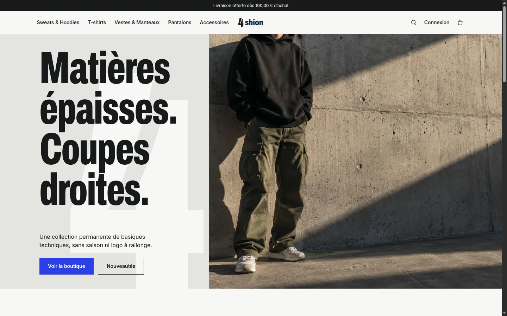
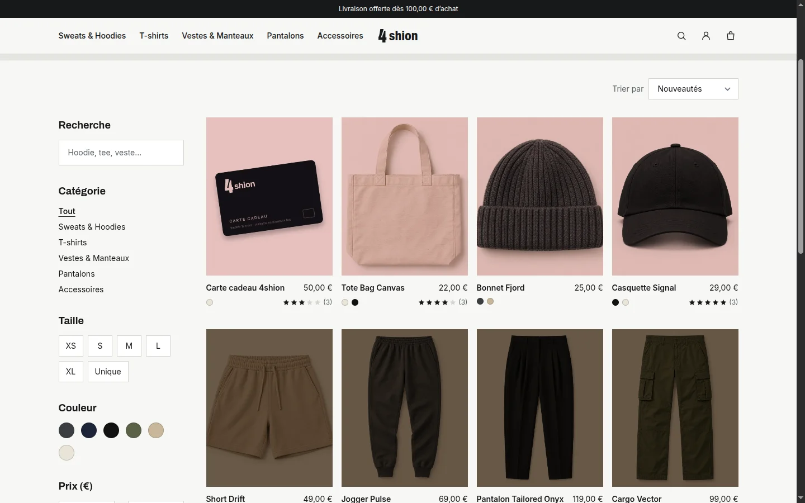
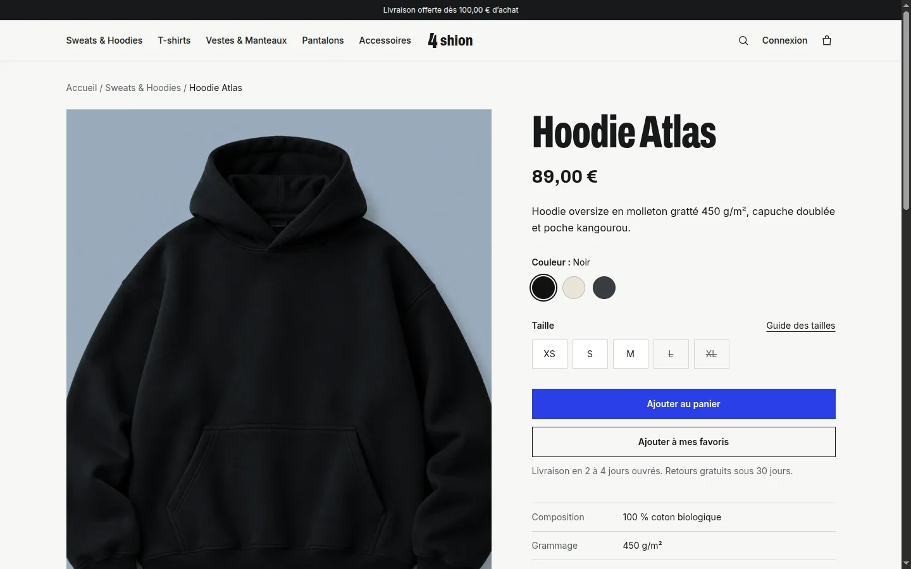
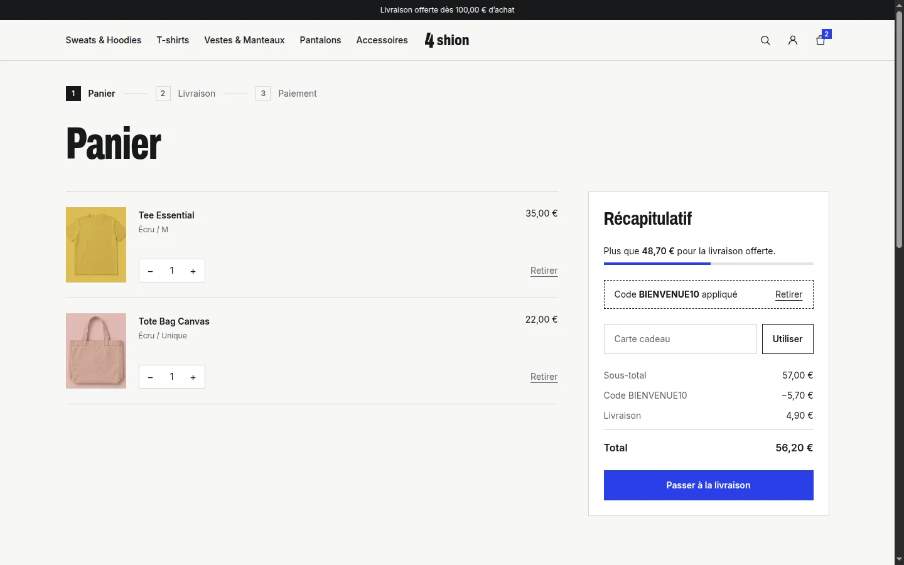
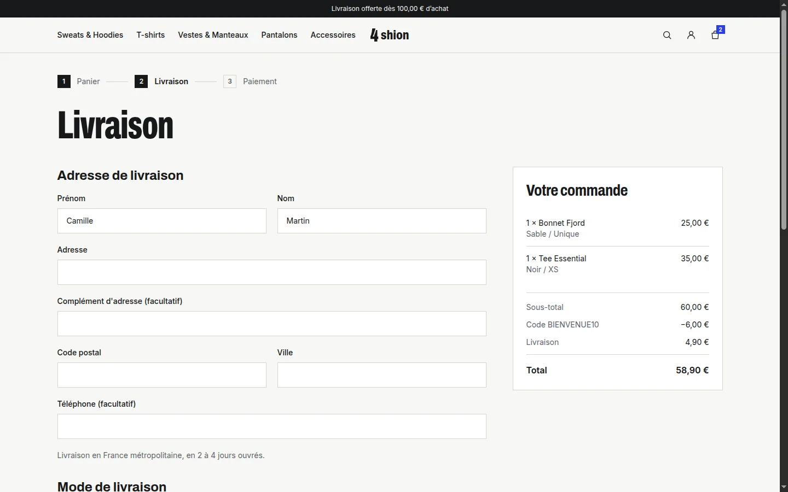
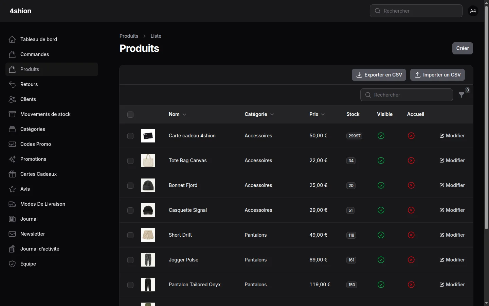
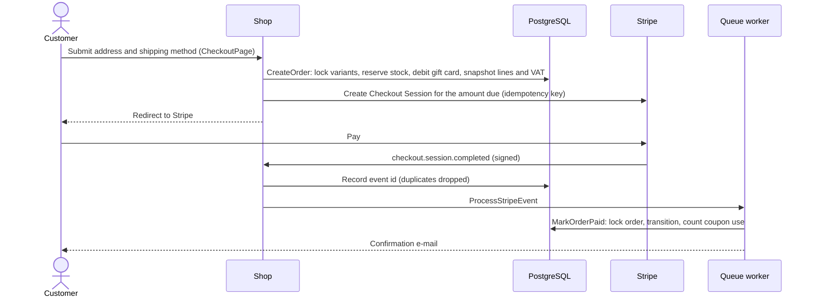
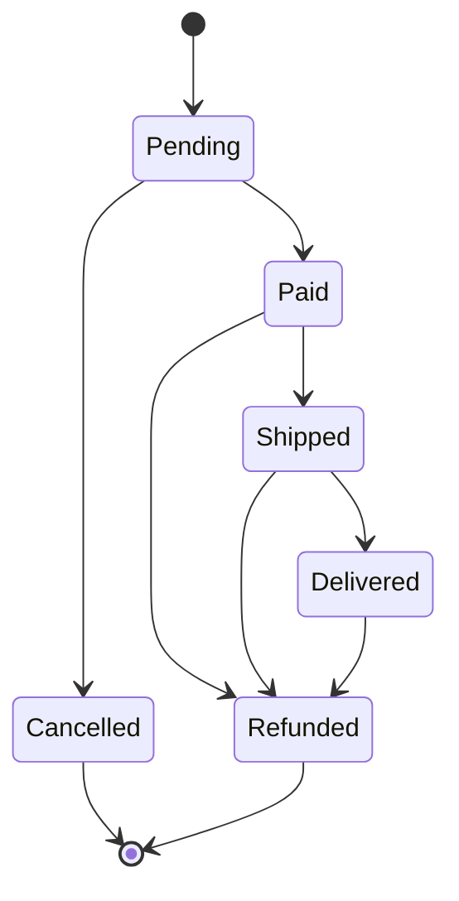
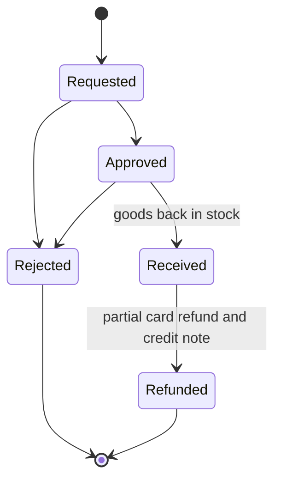

# 4shion


4shion is a Paris clothing label with one permanent collection of technical basics: no seasons, no oversized logos.
This repository is its online store. It holds the storefront, the customer account and the back office, which covers
orders, stock, shipping, returns and marketing.



The storefront speaks French, with English available on the main pages. Code, commits and documentation are in English.

## Features

**Catalogue and search**
- Categories, product variants by size and colour with stock per variant, size guide
- Full-text search through Scout and Meilisearch; filters and sorting kept in the URL
- Recently viewed products and "you may also like" recommendations

**Cart and pricing**
- Persistent cart, merged into the customer's own when they sign in, with a free-shipping progress bar
- Scheduled sales (percentage off per product), automatic promotions (spend threshold, buy X get the cheapest free)
- Coupons: percentage, fixed or free shipping; minimum spend, total and per-customer caps, first order only, sale
  items excluded
- Gift cards that can be bought, sent by e-mail and spent in part or in full at checkout

**Checkout and payments**
- Stripe Checkout, with the payment methods set by configuration (cards, PayPal, Klarna, Apple Pay)
- Guest checkout, stock reserved when the order is created, and pre-orders on sold-out variants
- Signed, deduplicated Stripe webhooks processed on the queue; abandoned orders released on a schedule

**Orders, shipping and returns**
- Several shipping methods, partial shipments with carrier and tracking link, packing slips
- Returns (RMA): request from the customer account, approval, receipt, partial refund and PDF credit note
- Order status timeline, PDF invoices, transactional e-mails for every step

**Inventory**
- Stock ledger recording every movement with its reason, low-stock thresholds, back-in-stock alerts by e-mail

**Customer account**
- Orders, address book, shareable wishlist, product reviews (helpful votes, merchant replies)
- Reminder e-mail for abandoned carts

**Back office** (Filament)
- Dashboard with KPIs over a chosen period, revenue chart, top products, coupon performance, low stock
- Products, categories, promotions, coupons, gift cards, shipping methods, journal posts, review moderation
- Orders: ship (in full or in part), bulk ship, refund, internal notes; customer files
- Staff roles (admin, preparer, support), activity log, CSV exports and catalogue CSV import

**Content, SEO and compliance**
- Journal (blog), category landing pages, sitemap, robots.txt, canonical URLs, Open Graph and JSON-LD
- Google Merchant product feed
- Newsletter with double opt-in, cookie consent, personal data export and account deletion (GDPR)

**Security**
- Two-factor authentication required for staff, e-mail alert on a sign-in from a new IP address
- Rate limits on sign-in, coupon and checkout attempts

## Screenshots

| Catalogue | Product |
| --- | --- |
|  |  |
| **Cart** | **Checkout** |
|  |  |



## Stack

| Area | Tools |
| --- | --- |
| Backend | PHP 8.5, Laravel 13, Cashier (Stripe), Scout, spatie/laravel-medialibrary, DomPDF |
| Frontend | Livewire 4, Volt, Alpine, Tailwind CSS 3, Vite |
| Back office | Filament 5 |
| Data | PostgreSQL 18, Redis (cache, queue, sessions), Meilisearch |
| Quality | Pest 4 (with architecture and type coverage), Larastan at level max, Rector, Pint |
| Tooling | Laravel Sail, GitHub Actions, Mailpit |

## Getting started

Everything runs through Laravel Sail, so the host needs Docker but no PHP, Composer or Node. The application requires
PHP 8.5.12 or later for its security fixes (see commit `43ea99e`), and Composer's platform check enforces it.

```bash
cp .env.example .env
docker run --rm -u "$(id -u):$(id -g)" -v "$(pwd):/var/www/html" -w /var/www/html composer:2 composer install --ignore-platform-reqs
./vendor/bin/sail up -d
./vendor/bin/sail artisan key:generate
./vendor/bin/sail artisan storage:link
./vendor/bin/sail artisan migrate --seed
./vendor/bin/sail artisan scout:sync-index-settings
./vendor/bin/sail artisan scout:import "App\Models\Product"
./vendor/bin/sail npm install
./vendor/bin/sail npm run build
```

| Service | URL |
| --- | --- |
| Storefront | http://localhost |
| Back office | http://localhost/admin |
| Mailpit | http://localhost:8025 |

Seeded accounts (password `password`):

- Customer: `client@4shion.test`
- Admin: `admin@4shion.test` (two-factor setup is required on first sign-in; set `ADMIN_MFA_REQUIRED=false` to skip it
  locally)

Seeded coupons: `BIENVENUE10`, `PREMIUM20`, plus `EXPIRE`, which has expired.

The `queue` and `scheduler` Sail services run the worker and `schedule:work`, so e-mails show up in Mailpit shortly
after the action that sends them. During frontend work, `./vendor/bin/sail npm run dev` serves assets with hot reload.

### Payments

Add Stripe test keys to `.env` (`STRIPE_KEY`, `STRIPE_SECRET`), then forward webhooks to the app:

```bash
stripe listen --forward-to localhost/stripe/webhook
```

Copy the printed signing secret into `STRIPE_WEBHOOK_SECRET`. An order stays `pending` until the webhook confirms the
payment; the success page is a fallback. Extra payment methods are listed in `STRIPE_PAYMENT_METHODS`. The test suite
never calls Stripe, because it swaps the `CheckoutGateway` for a fake.

## Architecture

The code keeps Laravel's conventional layout. Each business operation is a final, invokable action, and every entry
point calls it: Livewire, Filament, webhooks and console commands. The reasoning behind each choice is recorded in
[`docs/adr`](docs/adr).

| Path | Role |
| --- | --- |
| `app/Actions` | Business operations: catalogue query and import, checkout, order lifecycle, shipments, returns, invoices and credit notes, GDPR export and deletion |
| `app/Cart` | Database-backed cart (`CartManager`) and pure totals calculation with promotions, coupons and gift cards (`CartTotals`) |
| `app/Inventory` | `StockLedger`, the only writer of stock: movements, pre-order allocation, restock events |
| `app/Payments` | `CheckoutGateway` contract and its Stripe implementation |
| `app/Catalog` | Recently viewed products and recommendations |
| `app/Enums` | Order and return lifecycles, staff roles, carriers, discount and stock movement types |
| `app/Events`, `app/Listeners`, `app/Jobs`, `app/Mail` | Stripe event processing, cart merge on sign-in, sign-in alerts, customer e-mails |
| `app/Console/Commands` | `orders:release-stale` (every 10 min), `carts:remind-abandoned` (hourly) |
| `app/Livewire`, `app/Filament` | Storefront and account components; back office resources and widgets |
| `config/shop.php` | Shipping, VAT, order TTL, returns window, invoice identity, category colours, size guide |

### Checkout and payment



If the customer abandons the payment, the stock and the gift card balance come back through the cancel page, the
`checkout.session.expired` webhook or the scheduled `orders:release-stale` command. An order fully covered by a gift
card never reaches Stripe.

### Order lifecycle



Every transition goes through `Order::transitionTo()`, and repeated or concurrent requests are no-ops. Partial
shipments and partial refunds do not add states. Shipments are tracked in their own table, and partial refunds are
amounts carried by returns.

### Returns



### Integrity

- Amounts are integers in cents everywhere. VAT rate and amount are frozen on each order, and `App\Support\Money`
  only formats.
- PostgreSQL check constraints reject negative stock or amounts and inconsistent order totals.
- Row locks protect stock, orders, gift card balances and returns. Stripe calls carry idempotency keys, and webhook
  events are stored once.
- Staff changes to catalogue, pricing, orders and returns are written to the activity log.

## Quality

| Check | Command | Gate |
| --- | --- | --- |
| Formatting | `composer lint` | Pint, strict types declared everywhere |
| Static analysis | `composer analyse` | Larastan, level max, no baseline |
| Refactoring | `composer refactor:check` | Rector with the PHP and Laravel rule sets |
| Tests | `pest` | 338 unit, feature and architecture tests |
| Line coverage | `composer test:coverage` | at least 85 % (currently 88.5 %) |
| Type coverage | `composer test:types` | at least 99 % |

Run them with `./vendor/bin/sail` in front. GitHub Actions runs all of them on PHP 8.5 against PostgreSQL on every
push and pull request. The architecture tests (`tests/Unit/ArchTest.php`) check that actions are final and invokable,
that domain code does not depend on Livewire or Filament, and that only `app/Payments` talks to Stripe.

## Roadmap

See [`docs/roadmap.md`](docs/roadmap.md).

## Design

Display type is Archivo (condensed) and body text is Inter. Each category has a colour field set in `config/shop.php`,
and product packshots are blended onto it. The `4` emblem is traced from the Archivo glyph
(`resources/views/components/shop/emblem.blade.php`).
