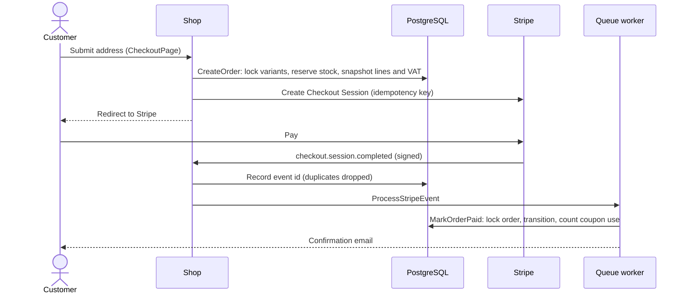
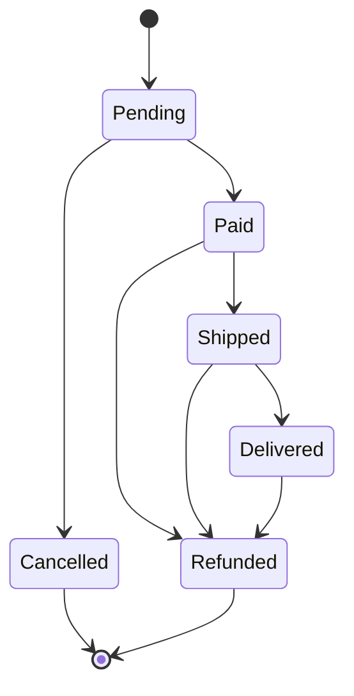

# 4shion

A clothing e-commerce site built with Laravel, written as a showcase of current Laravel practice. The storefront UI is in French; the code, commits and documentation are in English.

## Features

- Catalogue with categories, product variants (size and colour, stock per variant), full-text search (Scout and Meilisearch) and filters stored in the URL
- Persistent cart, merged on login, with coupon codes and a free-shipping progress bar
- Checkout through Stripe Checkout: stock reserved at order creation, signed and deduplicated webhooks processed on the queue, abandoned orders released on a schedule
- Customer account: orders with a status timeline, PDF invoices, address book, moderated product reviews
- Filament admin panel: products, categories, coupons, orders (ship, refund, invoice), review moderation and dashboard widgets
- Queued order confirmation and shipping emails

## Stack

Laravel 13, PHP 8.5 (Sail), Livewire 4, Alpine, Tailwind 3, Vite, Filament 5, Cashier, Scout, spatie/laravel-medialibrary, PostgreSQL, Redis, Meilisearch, Mailpit. Tests run on Pest (including architecture tests), static analysis on Larastan (level max), refactoring rules on Rector, formatting on Pint.

## Getting started

Everything runs through Laravel Sail; PHP, Composer and Node are not needed on the host. The application requires
PHP 8.5.12 or later, the first release with fixes for the October 2026 bailout state-corruption advisories
(GHSA-w8hw-w9fx-j79w, GHSA-6wmf-4rv5-p3rp) and including the pdo_pgsql quoting fix (CVE-2026-17543) from 8.5.9;
Composer's platform check refuses to boot on an older runtime.

```bash
cp .env.example .env
docker run --rm -u "$(id -u):$(id -g)" -v "$(pwd):/var/www/html" -w /var/www/html composer:2 composer install --ignore-platform-reqs
./vendor/bin/sail up -d
./vendor/bin/sail artisan key:generate
./vendor/bin/sail artisan storage:link
./vendor/bin/sail artisan migrate --seed
./vendor/bin/sail artisan scout:sync-index-settings
./vendor/bin/sail artisan scout:import "App\Models\Product"
./vendor/bin/sail npm install
./vendor/bin/sail npm run build
```

| Service | URL |
| --- | --- |
| Storefront | http://localhost |
| Admin panel | http://localhost/admin |
| Mailpit | http://localhost:8025 |

Emails and Stripe events are queued: the `queue` Sail service runs the worker, so confirmation emails appear in Mailpit shortly after a payment. The `scheduler` service runs scheduled tasks.

Seeded accounts (password `password`):

- Customer: `client@4shion.test`
- Admin: `admin@4shion.test`

Seeded coupons: `BIENVENUE10`, `PREMIUM20` and an expired `EXPIRE`.

During frontend work, `./vendor/bin/sail npm run dev` serves assets with hot reload.

## Payments

Add your Stripe test keys to `.env` (`STRIPE_KEY`, `STRIPE_SECRET`), then forward webhooks to the app:

```bash
stripe listen --forward-to localhost/stripe/webhook
```

Copy the printed signing secret into `STRIPE_WEBHOOK_SECRET`. An order stays `pending` until the webhook (or, as a fallback, the success page) confirms the payment. The test suite never calls Stripe: it swaps the `CheckoutGateway` for a fake.

## Quality checks

```bash
./vendor/bin/sail composer lint             # Pint, strict types included
./vendor/bin/sail composer analyse          # Larastan, level max
./vendor/bin/sail composer refactor:check   # Rector, Laravel rule sets
./vendor/bin/sail pest                      # unit, feature and architecture tests
./vendor/bin/sail composer test:coverage    # fails under 85 % line coverage
./vendor/bin/sail composer test:types       # fails under 99 % type coverage
```

GitHub Actions (`.github/workflows/ci.yml`) runs all of them on PHP 8.5 against PostgreSQL.

## Architecture

Conventional Laravel layout; business operations live in single-purpose actions that every entry point
(Livewire, Filament, webhooks, console) calls. The reasoning behind each choice is recorded in
[`docs/adr`](docs/adr).

| Path | Role |
| --- | --- |
| `app/Actions` | Business operations: catalogue query, checkout, order lifecycle, invoice |
| `app/Cart` | Database-backed cart (`CartManager`) and pure totals calculation (`CartTotals`) |
| `app/Payments` | `CheckoutGateway` contract and its Stripe implementation |
| `app/Jobs`, `app/Listeners` | Stripe event processing, cart merge on login, order emails |
| `app/Enums/OrderStatus.php` | Order lifecycle and allowed transitions |
| `app/Data` | Value objects (`ShippingAddress`, cast onto orders) |
| `app/Livewire`, `app/Filament` | Storefront and account components; admin panel |
| `config/shop.php` | Shipping, VAT, pending order TTL, invoice identity, category colours, size guide |

### Checkout and payment



If the customer abandons the payment, the stock comes back through the cancel page, the
`checkout.session.expired` webhook or the scheduled `orders:release-stale` command.

### Order lifecycle



Every transition goes through `Order::transitionTo()`; repeated or concurrent requests are no-ops.

### Integrity

- Amounts are integers in cents everywhere; `App\Support\Money` only formats them.
- PostgreSQL check constraints reject negative stock or amounts and inconsistent order totals.
- Coupon and checkout attempts are rate limited per visitor and per customer.
- The `queue` and `scheduler` Sail services run the worker and `schedule:work`.

## Design

Display type is Archivo (condensed), body text is Inter. Each category owns a colour field set in `config/shop.php`; product packshots are blended onto it. The `4` emblem is traced from the Archivo glyph (`resources/views/components/shop/emblem.blade.php`).
